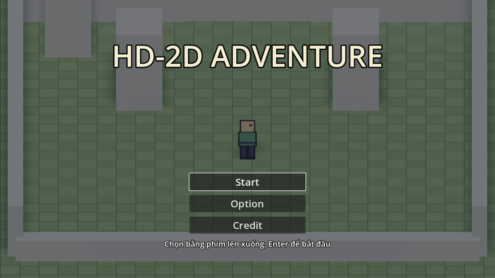

# HD-2D Adventure

[](https://github.com/Duzng510/hd2d-adventure/actions/workflows/ci.yml)


A fantasy semi-open-world real-time action RPG rendered in **HD-2D** — 3D scene, depth-lit camera, and flat pixel-art billboards — built in **Godot 4** with typed GDScript.

The project is developed spec-first: a design document defines the experience, a process document defines how a task is executed and validated, and every claimed result points at an artifact in the repository (a log, a screenshot, a graded harness run) rather than at an opinion.



## Status

| Phase | Scope | Outcome |
|---|---|---|
| **A** | Movement, camera, HD-2D pixel grid | Exited under waiver **D-009**. Gates 1–5 met; texel grid and whole-pixel camera snap locked (0 px residual). |
| **B** | Combat prototype: attacks, dodge, hitboxes, enemy AI, encounter loop | Exited under waiver **D-012**. B1–B6 and D gates Passed; **B7 Failed** — a spam-test harness wins 10/10 runs, so button-mashing is still not punished. Kept as a recorded failure. |
| **C** | Arena: 3 waves, ranged enemy, two-phase mini-boss, reward | **Closed by D-018** without a tuning pass. Measured bottleneck: player throughput ≈ 4.8 dmg/s against a 300 HP boss (TTK ≈ 63 s). |
| **D** | UI and progression: stat sheet, per-wave buff choice, floating damage numbers | **Open.** T-029, T-030, T-031 done. |

The Minimum Viable Slice acceptance criteria (MVS-AC1…8) are still `PROPOSED` and unverified — there is no end-to-end playable slice yet.

**At a glance:** 81 runtime scripts + 25 headless suites (~11k lines of GDScript), 40 scenes, 47 documents, 27 recorded decisions.

## Running it

Requires [Godot 4.7.2](https://godotengine.org/download/archive/) (Forward+ renderer, GDScript build — no .NET).

```bat
run.bat              " the game (title screen is the main scene)
run_arena.bat        " the Phase C arena with the L4 probe rig mounted
run.bat res://scenes/phase_a/phase_a_playground.tscn   " any other scene
```

Both wrappers call the engine with `--path .` and `--resolution 1280x720`, so no editor needs to be open; `run_arena.bat` loads `play_arena.tscn`, which wraps the arena in the capture rig and writes a probe CSV plus a PNG at each death. Point `GODOT_EXE` inside the two `.bat` files at your own engine binary. On Windows, `Ctrl+Shift+B` runs the `godot: run game` task from `.vscode/tasks.json`.

### Controls

| Key | Action |
|---|---|
| `W A S D` | Move |
| Mouse | Aim |
| `LMB` | Attack (3-hit combo) |
| `Space` | Dodge |
| `Esc` | Character sheet (pauses the game) |
| `↑ ↓ Enter` | Pick a buff after waves 1 and 2 |
| `R` | Reset the encounter |
| `F1` | Draw hitboxes and hurtboxes |
| `P` | Toggle perspective / orthographic |
| `L` | Toggle the frame log |

Art is **placeholder**: sprites, textures and UI panels are generated in code from a locked palette. The look is intentionally not representative of the final game — the pixel-grid law is.

## Testing

Four validation levels, defined in `AGENTS.md` and enforced by CI:

| Level | What it proves | Command |
|---|---|---|
| **L1** static | Script parses and type-checks | `godot --headless --path . --check-only --script res://<file>.gd` |
| **L2** runtime | Scene loads and runs N physics frames without error | `godot --headless --path . res://<scene>.tscn --quit-after <N>` |
| **L3** visual | A rendered screenshot exists and was actually looked at | capture scenes under `scenes/**/capture_*.tscn` |
| **L4** playtest | Human feel, scored by a person, never inferred from logs | protocol in `docs/MASTER_PROMPT.md` §9 |

```bash
node tools/run_tests.mjs        # all 25 headless suites, one command
node tools/check_stat_source.mjs # law: one authoritative source per stat
node tools/run_evidence.mjs     # grades Phase C gates E1–E5, incl. negative controls
node tools/score_l4.mjs         # scores the objective half of C1/C3 from a session CSV
```

`GODOT=<path-to-binary>` overrides the engine path for all four tools.

Two conventions make the numbers trustworthy:

- **Negative controls.** Every harness has a mutated twin that must exit non-zero and fail the *named* check. A green run only means something because red is reachable.
- **Self-tests.** `run_evidence.mjs --selftest` injects an expectation that cannot be met, so a green report also proves the grader itself can still say red.

## Architecture

- **Pure-logic kernels, thin nodes.** Combat timing, input buffering, wave progression, buff stacking, damage-number pooling and stat derivation live in `RefCounted` classes with no scene dependencies, so they run headless. Nodes only translate input and draw.
- **Ticks, not seconds.** Attack startup, active and recovery windows, i-frames and hit-stop are counted in physics frames at 60 tick/s inside `_physics_process`. Float `delta` is never used for a combat window.
- **Feel parameters are data.** Timing and damage values live in `.tres` resources or exported variables, with exactly one authoritative runtime reader — a rule checked mechanically by `tools/check_stat_source.mjs`, not by review.
- **HD-2D rendering law.** One texel equals one screen pixel, enforced by whole-pixel camera snapping (`D-008`); UI type sizes are multiples of 16 px and panel geometry multiples of 4 px.
- **Signal up, call down.** Node paths come from `const`/`preload`/exported resources; gameplay code reads no raw keys, only InputMap actions.

### Physics layers

| Layer | Name | Used by |
|---|---|---|
| 1 | `world` | Static floors, walls, obstacles |
| 2 | `player` | Player `CharacterBody3D` |
| 3 | `player_attack` | Player hitbox `Area3D` |
| 4 | `enemy_attack` | Enemy telegraphed-attack hitbox |
| 5 | `player_hurtbox` | Player hurtbox |
| 6 | `enemy_hurtbox` | Enemy hurtbox |

Masks point hitboxes at the opposing hurtbox layer only; hurtboxes listen to nothing.

## Repository layout

```
project.godot          Forward+ renderer, title screen as main scene
scenes/                phase_a … phase_d, ui, combat — incl. capture_*/run_* harnesses
scripts/               runtime code, mirrored by phase; *_kernel.gd files are renderer-free logic
  combat/              AttackState, InputBuffer, DodgeState, Health, HitRegistry, PlayerStats
tests/                 25 headless suites, one per kernel or law
tools/                 Node.js graders: test runner, evidence suite, stat-source law, L4 scorer
assets/                placeholder textures, VT323 font, ASSET_LOG.md (provenance + license)
docs/                  GDD, MASTER_PROMPT, STATE, DECISIONS, per-phase specs, plans and evidence
```

## Documentation

| File | Role |
|---|---|
| [`docs/GDD.md`](docs/GDD.md) | Source of truth for design (v0.7.1) |
| [`docs/MASTER_PROMPT.md`](docs/MASTER_PROMPT.md) | Source of truth for process (v3.4.1) |
| [`docs/STATE.md`](docs/STATE.md) | Source of truth for current status, per task |
| [`docs/DECISIONS.md`](docs/DECISIONS.md) | 27 dated decisions, including waivers and failures |
| [`docs/combat/COMBAT_SPEC.md`](docs/combat/COMBAT_SPEC.md) | Combat timing and damage spec |
| `docs/phase-*/` | Gate definitions, plans, and the evidence each gate cites |
| [`assets/ASSET_LOG.md`](assets/ASSET_LOG.md) | Every asset's origin, tool, date and license |

`docs/` is written in Vietnamese (technical terms left in English); code, comments and commit messages are English.

## Development workflow

One branch per task (`phase-d/t031-damage-numbers`), Conventional Commits scoped by task ID (`feat(T-031): …`), changes landing on `main` only through a PR with CI green. `main` is protected. Design decisions that trade away a gate are recorded as waivers with the measured number that motivated them — the spam-test failure and the closed-without-tuning Phase C are both on the record rather than quietly dropped.

## License

Copyright 2026 Duzng510. All rights reserved — see [LICENSE](LICENSE).

Third-party material is listed with provenance in `assets/ASSET_LOG.md`, including the VT323 font (Peter Hull, SIL Open Font License 1.1), whose text ships alongside the binary in `assets/ui/fonts/`.
